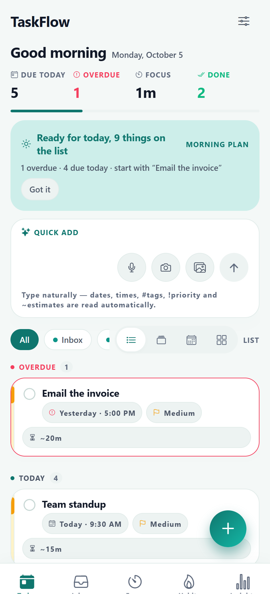
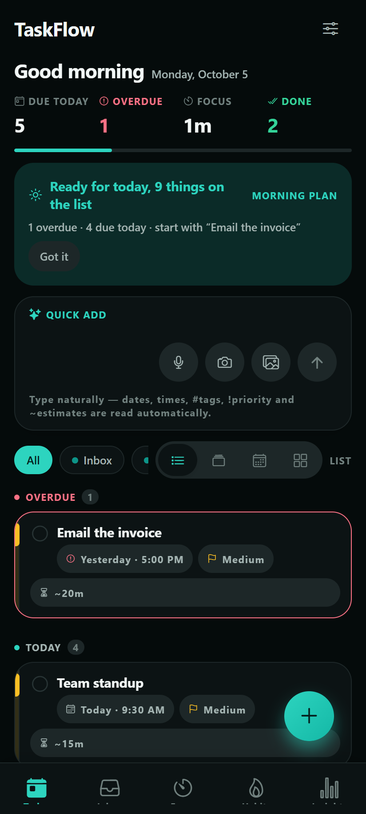
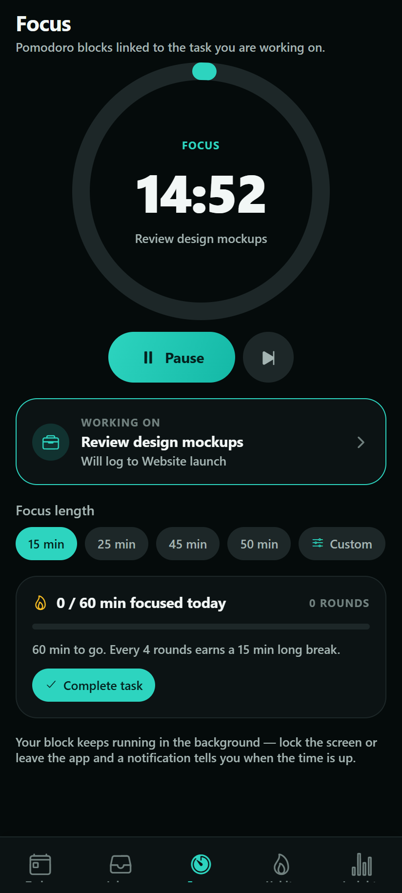
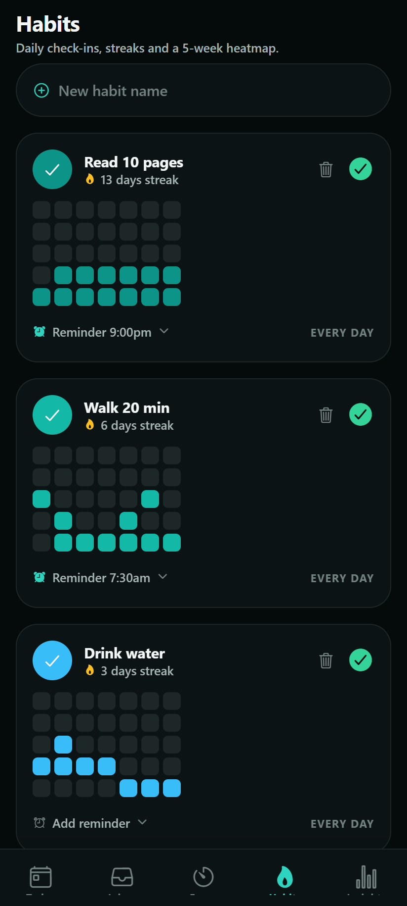
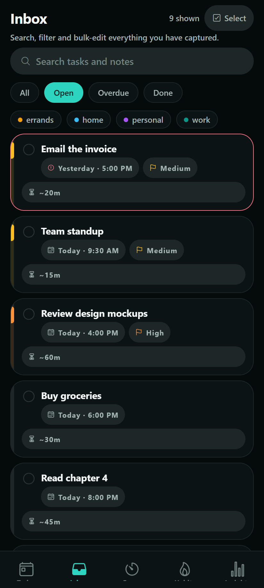
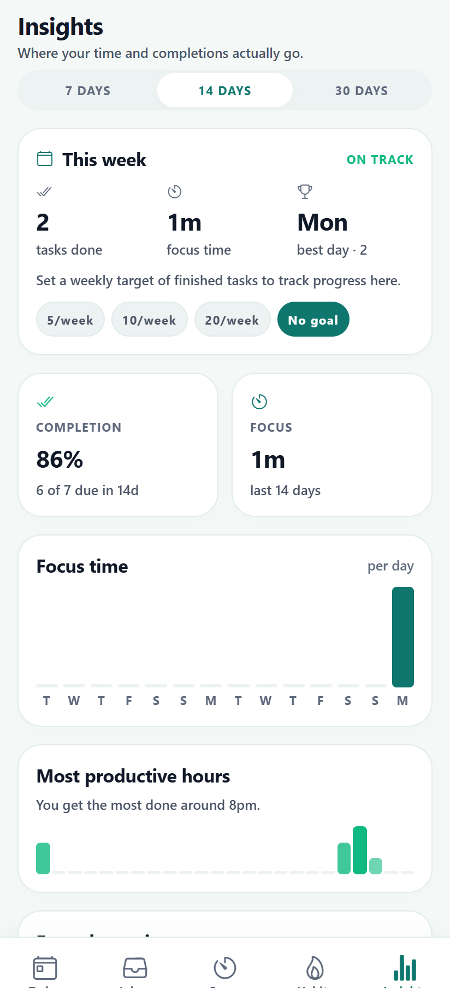
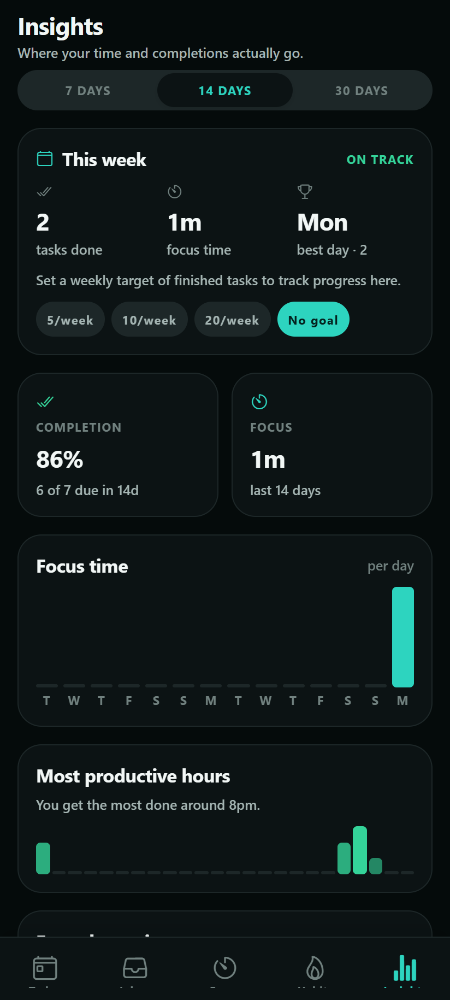

<div align="center">


<br />

[](https://github.com/Parth-191006/To-do/actions/workflows/ci.yml)
[](https://github.com/Parth-191006/To-do/releases/latest)
[](https://expo.dev)
[](LICENSE)

**Capture a thought in one line, spend a focus block on it, keep the habit.**

An offline-first Android to-do app: natural-language capture, a Pomodoro focus
timer, habit streaks and analytics, under a teal-accented light/dark design.
Everything runs on the device from a local SQLite database. No account is needed
to use it, and nothing is uploaded unless you deliberately configure a backend.

### → [Download TaskFlow-latest.apk](https://github.com/Parth-191006/To-do/releases/latest/download/TaskFlow-latest.apk)

</div>

---

## Screenshots

<!-- Light and dark, one row per screen. The cells marked TODO are the ones
     still to be captured — see docs/screenshots/ for the rest. -->

| Screen | Light | Dark |
| --- | --- | --- |
| **Today** — quick add with parsed chips |  |  |
| **Focus** — countdown ring, wheels inside it | <!-- TODO --> _light: to capture_ |  |
| **Habits** — streaks and a 5-week heatmap | <!-- TODO --> _light: to capture_ |  |
| **Inbox** — search, filters, bulk select | <!-- TODO --> _light: to capture_ |  |
| **Insights** — completion, focus, peak hours |  |  |

More captures — the chip parser mid-typing, the Kanban board, the custom-length
wheel picker — are in [`docs/screenshots/`](docs/screenshots), along with a short
tour GIF at [`docs/demo.gif`](docs/demo.gif).

---

## Install

Download **[`TaskFlow-latest.apk`](https://github.com/Parth-191006/To-do/releases/latest/download/TaskFlow-latest.apk)**
and open it on the phone. Allow *Install unknown apps* for whichever app you
downloaded it with, then open TaskFlow and grant the notification permission.

Sideloading, older builds and troubleshooting: [docs/INSTALL.md](docs/INSTALL.md).

---

## Features

**Capture** — type `Submit report tomorrow 5pm #Work !high ~45m` and the date,
time, tag, priority and estimate are recognised as you type and shown as chips.
Also voice notes with optional transcription, photo attachments, task templates
and a repeat-last shortcut. Anything that can open a URL can push text in:
`taskflow://add?text=…` shows what it parsed and asks before writing.

**Organise** — nested subtasks, colour-coded lists, tags and an inbox. Four
views over the same data: **List**, **Kanban**, **Calendar agenda** and
**Eisenhower matrix** — and all four can finish a task in place (swipe on List,
the advance arrow on Kanban, a checkbox in the agenda and the matrix) rather
than making you open it. Today is sorted Overdue → Today → Upcoming → Anytime →
Completed, with live counters, and search runs over SQLite FTS5.

**Focus** — a large countdown ring bound to the task you are working on, with
short and long break cycles, a round counter and a daily-goal bar. The clock
re-derives from the wall clock, so a backgrounded timer does not drift.

**Habits** — one-tap starter suggestions, a streak flame, check-in and undo, and
a 5-week heatmap, with an optional reminder time and weekly target days.

**Insights** — completion rate, focus minutes per day, most productive hours and
focus by project over 7/14/30-day windows. Empty states say what unlocks each
chart rather than showing a blank.

**Reminders** — time, recurring and location alerts. Actionable banners offer
**Complete**, **Snooze 5m / 1h / Tomorrow**, **Open** and *start a focus block*;
a place alert offers **Complete**, **Snooze 1h** and **Open**. Each permission is
requested on first use, after a short explanation, and a place alert lands on the
same urgency channel as a timed one.

**Data** — export JSON or CSV, import from pasted JSON, an automatic local
backup written before anything destructive, and restore from either. Optional
biometric app lock.

**Optional cloud** — set two environment variables and the same lists sync
between people, with real-time updates and per-field merging. **Invite someone
by email:** the app mints a single-use token for that list, the link opens
TaskFlow on their phone and joins them to it. Sent before they have an account,
the invite is parked and replayed the moment they sign in. See
[docs/CONFIGURATION.md](docs/CONFIGURATION.md).

**Design** — light / dark / system themes, haptics, spring motion, and a palette
driven entirely from `src/theme/tokens.ts`. WCAG AA contrast in both themes,
TalkBack labels on icon buttons, and font scaling respected.

---

## Quick start

```bash
npm install
npx expo start          # press i (iOS), a (Android) or scan the QR code
```

Native modules (notifications, geofencing, audio, SQLite) need a development
build for full functionality:

```bash
npx expo run:android    # or: npx expo run:ios
```

Expo Go renders the UI, but local notifications, geofencing and background tasks
are restricted there. `npm run web` bundles the same screens for a quick look at
the UI; Android is the shipping target.

---

## Privacy

Your tasks, notes, habits, focus sessions, attachments and preferences live in
one SQLite file on the device. **There is no telemetry, no analytics SDK and no
crash reporter that uploads anything.**

- Nothing is uploaded while you stay local.
- An **opt-in crash log** (Settings → Diagnostics, **off by default**) keeps
  uncaught errors on this device only, after scrubbing email addresses, token-like
  runs and long digit strings. Nothing is sent anywhere; you can read it and
  share it yourself if you want to report a bug. Turning it off stops capture —
  it does not quietly delete what you chose to keep.
- The only network calls this build can make are the **optional** Supabase sync
  (only with your own credentials, after you sign in) and an AI breakdown or
  transcription endpoint if you configured one.
- A list invite leaves the device only as the link you chose to send. The token
  is minted server-side, single-use and expiring; the app never writes list
  membership itself.
- The subtask planner is **rule-based** — a keyword-matched template library that
  ships in the app — and it is both the default and the fallback, so it works in
  airplane mode. Pointing it at a remote model is an optional upgrade.
- Attachment bytes never leave the device; only their local URIs replicate.
- Backups and exports are files you choose to share.

Full detail, and the one table of what each environment variable can do:
[docs/CONFIGURATION.md](docs/CONFIGURATION.md) · [SECURITY.md](SECURITY.md).

---

## Known limitations

Stated here rather than discovered later:

- **No share-sheet entry.** TaskFlow does not appear in Android's *Share* menu.
  An inbound share needs an `ACTION_SEND` intent filter read from the launching
  Intent, and React Native only surfaces `ACTION_VIEW` — so it requires a native
  module and a development build. The link route above (`taskflow://add?text=…`)
  covers the same ground for anything that can open a URL: a bookmarklet, an
  automation app, a shortcut, a bot.
- **No drag-and-drop on the board.** Moving a card is a tap on the advance
  arrow: a drag is unreachable with a screen reader and easy to trigger by
  accident in a horizontal lane.
- **Notifications, geofences and exact alarms are verified by inspection, not on
  hardware.** The code paths are complete and the release workflow builds the
  APK, but sound, vibration, lock-screen actions, OEM notification quirks and
  geofence wake-ups need a real phone. Anything still unverified is called out in
  [docs/AUDIT.md](docs/AUDIT.md).
- **Android only.** There is no sideloadable iOS build; TestFlight through EAS
  is the only public path. The APK is sideloaded, so there is no Play Protect
  review and no automatic update channel.
- **App lock is a privacy screen,** not encryption: it gates the UI, and the
  SQLite file is protected only by whatever full-disk encryption the OS does.

---

## Links

| | |
| --- | --- |
| Architecture, data schema, sync strategy | [ARCHITECTURE.md](ARCHITECTURE.md) |
| Building, testing, the E2E flows, platform notes | [docs/DEVELOPMENT.md](docs/DEVELOPMENT.md) |
| Releasing, signing, app size | [docs/RELEASING.md](docs/RELEASING.md) |
| Optional backend, AI endpoints, permissions | [docs/CONFIGURATION.md](docs/CONFIGURATION.md) |
| Sideloading help | [docs/INSTALL.md](docs/INSTALL.md) |
| Feature-by-feature audit | [docs/AUDIT.md](docs/AUDIT.md) |
| Security policy | [SECURITY.md](SECURITY.md) |
| Changelog · Contributing · Code of conduct | [CHANGELOG.md](CHANGELOG.md) · [CONTRIBUTING.md](CONTRIBUTING.md) · [CODE_OF_CONDUCT.md](CODE_OF_CONDUCT.md) |

## License

Released under the [MIT License](LICENSE).

Built with [Expo](https://expo.dev), [React Native](https://reactnative.dev),
[SQLite](https://www.sqlite.org) and [Supabase](https://supabase.com).
